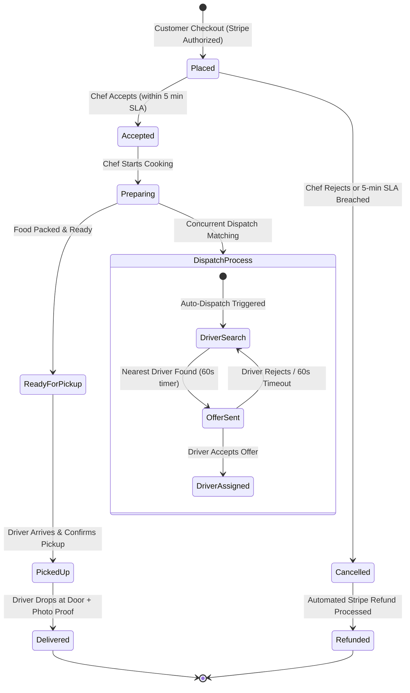

# RideNDine Application Flow Document

> **Document 03 – Application Flow Document** | Project: RideNDine Marketplace | Date: October 7, 2026 | Commit: `5599c2e5` | Author: AI-generated from codebase audit | Confidence Summary: 42 CONFIRMED / 2 INFERRED / 0 UNKNOWN

---

## 1. Overview & Navigation Architecture

RideNDine is structured as four distinct web applications, each tailored with dedicated navigation paradigms suited to its operational context:
- **Customer Web (`ridendine.ca`):** Top sticky navigation bar with search bar, cart drawer trigger with item badge, and user account dropdown; mobile bottom navigation bar on handheld screens `[CONFIRMED: apps/web/src/components/layout/header.tsx]`.
- **Chef Admin (`chef.ridendine.ca`):** Collapsible left sidebar containing kitchen workflow links (Live Queue, Orders, Menu, Availability, Recipes, Inventory, Storefront, Payouts, Reviews, Settings); top bar with live audio toggle and operational status indicator `[CONFIRMED: apps/chef-admin/src/components/layout/sidebar.tsx]`.
- **Driver App (`driver.ridendine.ca`):** Mobile-first PWA layout with persistent bottom navigation bar (Work Dashboard, Offers, Shifts, Earnings, Profile) and full-screen dispatch modals with tactile swipe actions `[CONFIRMED: apps/driver-app/src/components/layout/driver-nav.tsx]`.
- **Ops Admin (`ops.ridendine.ca`):** Dense command-center sidebar (Live Board, Orders, Dispatch, Chefs, Drivers, Support, Finance, Settings, Audit); top banner with live system alerts and SLA breach warnings `[CONFIRMED: apps/ops-admin/src/components/layout/ops-sidebar.tsx]`.

---

## 2. Route & Screen Inventory

### Customer Web (`apps/web` — `ridendine.ca`)
| Route / URL | Screen Name | Purpose | Access Level | Reached From | Leads To | Source File |
| :--- | :--- | :--- | :--- | :--- | :--- | :--- |
| `/` | Marketplace Home | Discover local kitchens, browse featured dishes, view cuisines. | Public | Direct / External | `/chefs/[slug]`, `/auth/login` | [`apps/web/src/app/page.tsx`](file:///D:/Projects/RIDENDINE/ridendine-marketplace/apps/web/src/app/page.tsx) |
| `/chefs/[slug]` | Storefront View | View a specific chef's menu, biography, hours, and dishes. | Public | Home / Search | Dish Modal, `/checkout` | [`apps/web/src/app/chefs/[slug]/page.tsx`](file:///D:/Projects/RIDENDINE/ridendine-marketplace/apps/web/src/app/chefs/[slug]/page.tsx) |
| `/checkout` | Checkout Flow | Address selection, delivery instructions, tip, Stripe pay. | Customer Auth | Cart Drawer | `/orders/[id]` | [`apps/web/src/app/checkout/page.tsx`](file:///D:/Projects/RIDENDINE/ridendine-marketplace/apps/web/src/app/checkout/page.tsx) |
| `/orders/[id]` | Order Tracking | Real-time map, status timeline, driver location, receipt. | Customer Auth | Checkout / Orders | Home / Support | [`apps/web/src/app/orders/[id]/page.tsx`](file:///D:/Projects/RIDENDINE/ridendine-marketplace/apps/web/src/app/orders/[id]/page.tsx) |
| `/account/orders` | Order History | Historical list of customer past orders with re-order. | Customer Auth | Header Menu | `/orders/[id]` | [`apps/web/src/app/account/orders/page.tsx`](file:///D:/Projects/RIDENDINE/ridendine-marketplace/apps/web/src/app/account/orders/page.tsx) |
| `/account/addresses`| Saved Addresses | Add, edit, or delete customer delivery locations. | Customer Auth | Account Menu | Checkout | [`apps/web/src/app/account/addresses/page.tsx`](file:///D:/Projects/RIDENDINE/ridendine-marketplace/apps/web/src/app/account/addresses/page.tsx) |
| `/auth/login` | Customer Sign In | Email/password sign-in and Google OAuth login. | Public | Header / Checkout | `/`, Previous Page | [`apps/web/src/app/auth/login/page.tsx`](file:///D:/Projects/RIDENDINE/ridendine-marketplace/apps/web/src/app/auth/login/page.tsx) |
| `/auth/signup` | Customer Register| Create new customer profile. | Public | Login Page | `/` | [`apps/web/src/app/auth/signup/page.tsx`](file:///D:/Projects/RIDENDINE/ridendine-marketplace/apps/web/src/app/auth/signup/page.tsx) |
| `/privacy` | Privacy Policy | Legal statement on data collection, storage, and retention. | Public | Footer | `/terms` | [`apps/web/src/app/privacy/page.tsx`](file:///D:/Projects/RIDENDINE/ridendine-marketplace/apps/web/src/app/privacy/page.tsx) |
| `/terms` | Terms of Service | Customer marketplace terms and conditions. | Public | Footer | `/privacy` | [`apps/web/src/app/terms/page.tsx`](file:///D:/Projects/RIDENDINE/ridendine-marketplace/apps/web/src/app/terms/page.tsx) |

### Chef Admin (`apps/chef-admin` — `chef.ridendine.ca`)
| Route / URL | Screen Name | Purpose | Access Level | Reached From | Leads To | Source File |
| :--- | :--- | :--- | :--- | :--- | :--- | :--- |
| `/dashboard` | Chef Dashboard | Live action queue, prep timeline, earnings snapshot. | Approved Chef | Login | Orders, Menu, Payouts | [`apps/chef-admin/src/app/dashboard/page.tsx`](file:///D:/Projects/RIDENDINE/ridendine-marketplace/apps/chef-admin/src/app/dashboard/page.tsx) |
| `/dashboard/orders` | Orders Queue | List of active, preparing, and completed orders. | Approved Chef | Sidebar | `/dashboard/orders/[id]` | [`apps/chef-admin/src/app/dashboard/orders/page.tsx`](file:///D:/Projects/RIDENDINE/ridendine-marketplace/apps/chef-admin/src/app/dashboard/orders/page.tsx) |
| `/dashboard/orders/[id]`| Order Detail | Accept/Reject order, mark Preparing, Ready for Pickup. | Approved Chef | Orders Queue | Orders Queue | [`apps/chef-admin/src/app/dashboard/orders/[id]/page.tsx`](file:///D:/Projects/RIDENDINE/ridendine-marketplace/apps/chef-admin/src/app/dashboard/orders/[id]/page.tsx) |
| `/dashboard/menu` | Menu Catalog | CRUD categories, menu items, prices, 86/sold-out toggles. | Approved Chef | Sidebar | Item Editor | [`apps/chef-admin/src/app/dashboard/menu/page.tsx`](file:///D:/Projects/RIDENDINE/ridendine-marketplace/apps/chef-admin/src/app/dashboard/menu/page.tsx) |
| `/dashboard/storefront`| Storefront Editor | Kitchen bio, cuisine tags, logo, banner, prep time buffers. | Approved Chef | Sidebar | Setup Wizard | [`apps/chef-admin/src/app/dashboard/storefront/page.tsx`](file:///D:/Projects/RIDENDINE/ridendine-marketplace/apps/chef-admin/src/app/dashboard/storefront/page.tsx) |
| `/dashboard/availability`| Operating Hours | Day-of-week operating hours and vacation pause mode. | Approved Chef | Sidebar | Storefront | [`apps/chef-admin/src/app/dashboard/availability/page.tsx`](file:///D:/Projects/RIDENDINE/ridendine-marketplace/apps/chef-admin/src/app/dashboard/availability/page.tsx) |
| `/dashboard/recipes` | Recipe Costing | Ingredient quantities, batch cost, profit margin analytics. | Approved Chef | Sidebar | Inventory | [`apps/chef-admin/src/app/dashboard/recipes/page.tsx`](file:///D:/Projects/RIDENDINE/ridendine-marketplace/apps/chef-admin/src/app/dashboard/recipes/page.tsx) |
| `/dashboard/inventory`| Inventory Tracker | Raw material tracking, waste events, supplier items. | Approved Chef | Sidebar | Recipes | [`apps/chef-admin/src/app/dashboard/inventory/page.tsx`](file:///D:/Projects/RIDENDINE/ridendine-marketplace/apps/chef-admin/src/app/dashboard/inventory/page.tsx) |
| `/dashboard/payouts` | Payouts & Stripe | Stripe Express Connect onboarding and payout history. | Approved Chef | Sidebar | Stripe Express | [`apps/chef-admin/src/app/dashboard/payouts/page.tsx`](file:///D:/Projects/RIDENDINE/ridendine-marketplace/apps/chef-admin/src/app/dashboard/payouts/page.tsx) |
| `/dashboard/reviews` | Customer Reviews| Rating history and customer feedback comments. | Approved Chef | Sidebar | Dashboard | [`apps/chef-admin/src/app/dashboard/reviews/page.tsx`](file:///D:/Projects/RIDENDINE/ridendine-marketplace/apps/chef-admin/src/app/dashboard/reviews/page.tsx) |
| `/auth/login` | Chef Portal Login | Credentials sign in for registered kitchen operators. | Public | Direct | `/dashboard` | [`apps/chef-admin/src/app/auth/login/page.tsx`](file:///D:/Projects/RIDENDINE/ridendine-marketplace/apps/chef-admin/src/app/auth/login/page.tsx) |
| `/auth/signup` | Chef Onboarding | New kitchen partner registration form. | Public | Login | `/dashboard/storefront/setup` | [`apps/chef-admin/src/app/auth/signup/page.tsx`](file:///D:/Projects/RIDENDINE/ridendine-marketplace/apps/chef-admin/src/app/auth/signup/page.tsx) |

### Driver App (`apps/driver-app` — `driver.ridendine.ca`)
| Route / URL | Screen Name | Purpose | Access Level | Reached From | Leads To | Source File |
| :--- | :--- | :--- | :--- | :--- | :--- | :--- |
| `/` | Work Dashboard | Online shift toggle, active dispatch offer modal, live task. | Approved Driver| Login | Delivery Route | [`apps/driver-app/src/app/page.tsx`](file:///D:/Projects/RIDENDINE/ridendine-marketplace/apps/driver-app/src/app/page.tsx) |
| `/deliveries/[id]` | Delivery Execution | Pickup checklist, customer routing, photo proof upload. | Approved Driver| Dashboard | Dashboard | [`apps/driver-app/src/app/deliveries/[id]/page.tsx`](file:///D:/Projects/RIDENDINE/ridendine-marketplace/apps/driver-app/src/app/deliveries/[id]/page.tsx) |
| `/earnings` | Earnings Summary | Completed deliveries, delivery pay, tips, settlement status. | Approved Driver| Navigation | Dashboard | [`apps/driver-app/src/app/earnings/page.tsx`](file:///D:/Projects/RIDENDINE/ridendine-marketplace/apps/driver-app/src/app/earnings/page.tsx) |
| `/documents` | Vehicle & License | License photo, insurance expiry, vehicle registration. | Driver Auth | Navigation | Dashboard | [`apps/driver-app/src/app/documents/page.tsx`](file:///D:/Projects/RIDENDINE/ridendine-marketplace/apps/driver-app/src/app/documents/page.tsx) |
| `/profile` | Driver Profile | Contact details, phone number, vehicle settings, logout. | Driver Auth | Navigation | `/auth/login` | [`apps/driver-app/src/app/profile/page.tsx`](file:///D:/Projects/RIDENDINE/ridendine-marketplace/apps/driver-app/src/app/profile/page.tsx) |
| `/auth/login` | Driver Sign In | Driver authentication portal. | Public | Direct | `/` | [`apps/driver-app/src/app/auth/login/page.tsx`](file:///D:/Projects/RIDENDINE/ridendine-marketplace/apps/driver-app/src/app/auth/login/page.tsx) |
| `/auth/signup` | Driver Onboarding | Sign up to deliver with RideNDine. | Public | Login | `/documents` | [`apps/driver-app/src/app/auth/signup/page.tsx`](file:///D:/Projects/RIDENDINE/ridendine-marketplace/apps/driver-app/src/app/auth/signup/page.tsx) |

### Ops Admin (`apps/ops-admin` — `ops.ridendine.ca`)
| Route / URL | Screen Name | Purpose | Access Level | Reached From | Leads To | Source File |
| :--- | :--- | :--- | :--- | :--- | :--- | :--- |
| `/dashboard` | Live Operations Board | Real-time kanban swimlanes of orders, active fleet count. | Ops Staff | Login | Order Detail | [`apps/ops-admin/src/app/dashboard/page.tsx`](file:///D:/Projects/RIDENDINE/ridendine-marketplace/apps/ops-admin/src/app/dashboard/page.tsx) |
| `/dashboard/orders` | Orders Management | Search, filter, inspect all orders with lifecycle status. | Ops Staff | Sidebar | Order Detail | [`apps/ops-admin/src/app/dashboard/orders/page.tsx`](file:///D:/Projects/RIDENDINE/ridendine-marketplace/apps/ops-admin/src/app/dashboard/orders/page.tsx) |
| `/dashboard/orders/[id]`| Order Command Center| Manual driver reassignment, cancel order, force status. | Ops Staff | Live Board | Orders | [`apps/ops-admin/src/app/dashboard/orders/[id]/page.tsx`](file:///D:/Projects/RIDENDINE/ridendine-marketplace/apps/ops-admin/src/app/dashboard/orders/[id]/page.tsx) |
| `/dashboard/dispatch` | Fleet Live Map | Real-time map of all online drivers with status indicators. | Ops Staff | Sidebar | Driver Detail | [`apps/ops-admin/src/app/dashboard/dispatch/page.tsx`](file:///D:/Projects/RIDENDINE/ridendine-marketplace/apps/ops-admin/src/app/dashboard/dispatch/page.tsx) |
| `/dashboard/chefs` | Chef Management | Kitchen verification, document review, storefront pause. | Ops Staff | Sidebar | Chef Detail | [`apps/ops-admin/src/app/dashboard/chefs/page.tsx`](file:///D:/Projects/RIDENDINE/ridendine-marketplace/apps/ops-admin/src/app/dashboard/chefs/page.tsx) |
| `/dashboard/drivers` | Driver Management | Background check verification, license validation. | Ops Staff | Sidebar | Driver Detail | [`apps/ops-admin/src/app/dashboard/drivers/page.tsx`](file:///D:/Projects/RIDENDINE/ridendine-marketplace/apps/ops-admin/src/app/dashboard/drivers/page.tsx) |
| `/dashboard/support` | Support Desk | Customer complaint tickets, missing items, refund triage. | Support Agent | Sidebar | Ticket Resolution | [`apps/ops-admin/src/app/dashboard/support/page.tsx`](file:///D:/Projects/RIDENDINE/ridendine-marketplace/apps/ops-admin/src/app/dashboard/support/page.tsx) |
| `/dashboard/finance` | Finance Dashboard | GMV, net platform commission, driver payouts, sales tax. | Finance Mgr | Sidebar | Ledger | [`apps/ops-admin/src/app/dashboard/finance/page.tsx`](file:///D:/Projects/RIDENDINE/ridendine-marketplace/apps/ops-admin/src/app/dashboard/finance/page.tsx) |
| `/dashboard/ledger` | Double-Entry Ledger | Immutable credit/debit transaction log. | Finance Mgr | Sidebar | Finance | [`apps/ops-admin/src/app/dashboard/ledger/page.tsx`](file:///D:/Projects/RIDENDINE/ridendine-marketplace/apps/ops-admin/src/app/dashboard/ledger/page.tsx) |
| `/dashboard/payouts` | Payout Processor | Execute weekly Stripe Connect batch transfers. | Finance Mgr | Sidebar | Stripe Dashboard | [`apps/ops-admin/src/app/dashboard/payouts/page.tsx`](file:///D:/Projects/RIDENDINE/ridendine-marketplace/apps/ops-admin/src/app/dashboard/payouts/page.tsx) |
| `/dashboard/settings`| Platform Settings | Adjust commission %, base delivery fees, SLAs, radiuses. | Super Admin | Sidebar | Dashboard | [`apps/ops-admin/src/app/dashboard/settings/page.tsx`](file:///D:/Projects/RIDENDINE/ridendine-marketplace/apps/ops-admin/src/app/dashboard/settings/page.tsx) |
| `/dashboard/audit` | Audit Log | Read-only ledger of administrative actions and overrides. | Super Admin | Sidebar | Dashboard | [`apps/ops-admin/src/app/dashboard/audit/page.tsx`](file:///D:/Projects/RIDENDINE/ridendine-marketplace/apps/ops-admin/src/app/dashboard/audit/page.tsx) |
| `/auth/login` | Ops Console Login | Secure administrator sign in. | Public | Direct | `/dashboard` | [`apps/ops-admin/src/app/auth/login/page.tsx`](file:///D:/Projects/RIDENDINE/ridendine-marketplace/apps/ops-admin/src/app/auth/login/page.tsx) |

---

## 3. Key User Journeys

### Journey 1: Customer Order & Checkout
1. **Discovery:** Customer visits `https://ridendine.ca/`, enters delivery address or allows geolocation; platform filters open kitchens within 15 km.
2. **Selection:** Customer opens chef storefront (`/chefs/[slug]`), clicks a dish card, configures options (e.g. spice level), and clicks "Add to Order".
3. **Cart Review:** Customer opens cart drawer, reviews itemized subtotal, service fee, and estimated delivery fee.
4. **Checkout:** Customer proceeds to `/checkout`, selects saved address or inputs new address, adds driver tip ($2, $3, $5, or custom), and inputs credit card into Stripe Elements.
5. **Confirmation:** System creates order record in Supabase with `status: 'placed'` and redirects customer to `/orders/[id]` live tracking view.

### Journey 2: Chef Kitchen Fulfillment
1. **Alert:** Incoming order triggers audio alert and appears in Chef Admin (`/dashboard`) under "Today's Action Queue".
2. **Acceptance:** Chef reviews items and click "Accept Order" (within 5-min SLA window); status transitions to `accepted`.
3. **Preparation:** When cooking begins, chef clicks "Start Preparing"; status becomes `preparing`; dispatch engine initiates driver matching.
4. **Handoff:** When food is packed, chef clicks "Ready for Pickup"; status transitions to `ready_for_pickup`. Chef verifies driver ID on arrival and hands over package.

### Journey 3: Driver Dispatch & Delivery
1. **Shift Online:** Driver logs in to `https://driver.ridendine.ca/` and toggles shift toggle to "Go Online".
2. **Offer Dispatch:** When an order is preparing, dispatch engine identifies nearest driver; a 60-second offer modal appears with pickup/delivery distance and earnings.
3. **Acceptance:** Driver taps "Accept Offer"; delivery transitions to `assigned`.
4. **Pickup:** Driver navigates to kitchen, confirms pickup checklist in app, and taps "Confirm Pickup"; status becomes `in_transit`.
5. **Doorstep Delivery:** Driver navigates to customer address, drops food at door, takes photo verification in app, and taps "Complete Delivery"; status transitions to `delivered`.

---

## 4. Master Order Lifecycle State Diagram

