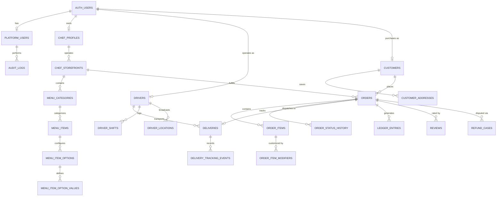

# RideNDine Backend Schema & API Catalog

> **Document 05 – Backend Schema & API Catalog** | Project: RideNDine Marketplace | Date: October 7, 2026 | Commit: `5599c2e5` | Author: AI-generated from codebase audit | Confidence Summary: 56 CONFIRMED / 0 INFERRED / 0 UNKNOWN

---

## 1. Overview & Database Architecture

RideNDine utilizes a high-availability **PostgreSQL 15** relational database hosted on Supabase, enhanced with the **PostGIS** geographic extension for spatial radius and distance calculations `[CONFIRMED: supabase/migrations/*.sql & information_schema.tables]`. 

### Key Database Statistics
- **Total Operational Tables:** 112 public tables (113 including PostGIS `spatial_ref_sys`) `[CONFIRMED: information_schema.tables]`.
- **Database Views:** 4 public views (`geography_columns`, `geometry_columns`, `order_status_events`, `partner_api_stats`) `[CONFIRMED: information_schema.tables]`.
- **Migrations:** 64 sequential migrations recorded in `supabase/migrations/` establishing referential integrity, indexes, and RLS policies `[CONFIRMED: supabase/migrations]`.
- **Connection Mechanisms:** Direct connection pooling via Node-postgres (`pg`) on port 5432/6543, and HTTP REST / WebSocket connection via `@supabase/supabase-js` `[CONFIRMED: packages/db]`.

---

## 2. Core Entity-Relationship Diagram

---

## 3. Database Table Catalog by Functional Domain

### Domain 1: Orders & Fulfillment (15 Tables) `[CONFIRMED: information_schema.tables]`
1. **`orders`:** Master order transaction table storing order number, customer ID, storefront ID, status, financial totals (subtotal, tax, tip, delivery fee, service fee, total), payment status, and prep timing.
2. **`order_items`:** Itemized dishes included in an order with quantity, unit price, item ID, and special kitchen instructions.
3. **`order_item_modifiers`:** Selected customizations and options chosen for each order item with incremental add-on pricing.
4. **`order_status_history`:** Audit trail recording exact timestamps and user IDs for every order state transition.
5. **`order_pack_checks`:** Checklists used by kitchen staff and drivers to verify dish packaging accuracy before handoff.
6. **`order_exceptions`:** Escalated incidents (e.g. food late, customer unavailable, damaged item) linked to specific orders.
7. **`deliveries`:** Delivery fulfillment record storing pickup address, delivery address, driver ID, delivery status, and timestamps.
8. **`delivery_assignments`:** Assignment records linking drivers to specific delivery runs.
9. **`delivery_tracking_events`:** Time-series GPS location breadcrumbs and status changes logged during transit.
10. **`assignment_attempts`:** Automated dispatch attempt log tracking 60-second driver offer lifecycles and acceptance status.
11. **`kitchen_tickets`:** Digital kitchen tickets routed to preparation lines.
12. **`kitchen_ticket_items`:** Individual line items assigned to specific prep tickets.
13. **`kitchen_queue_entries`:** Real-time queue positioning for kitchens operating under high order volume.
14. **`refund_cases`:** Formal customer dispute records tracking requested refund amounts, reasons, and Stripe refund IDs.
15. **`payout_adjustments`:** Credit/debit manual adjustments applied to orders, drivers, or chefs following support resolutions.

### Domain 2: Kitchens, Chefs & Menus (18 Tables) `[CONFIRMED: information_schema.tables]`
16. **`chef_profiles`:** Primary identity for kitchen creators storing legal name, display name, bio, phone, and verification status.
17. **`chef_storefronts`:** Public kitchen brand profiles with slug, cuisine tags, logo, banner image, queue limits, and status.
18. **`chef_kitchens`:** Commercial preparation facility addresses with geographic lat/lng coordinates and inspection records.
19. **`chef_availability`:** Recurring operating schedules defining open/close times per day of week.
20. **`chef_delivery_zones`:** Configured delivery polygons and distance boundaries defining where a kitchen delivers.
21. **`chef_documents`:** Uploaded food safety certificates, business licenses, and government IDs.
22. **`chef_payout_accounts`:** Linked Stripe Express Connect account IDs (`acct_*`) and verification states.
23. **`chef_payouts`:** Historical records of funds disbursed to chefs with Stripe transfer IDs.
24. **`menu_categories`:** Storefront menu groupings (e.g. Appetizers, Entrees, Desserts, Beverages).
25. **`menu_items`:** Individual dishes with pricing, descriptions, allergen tags, daily volume caps, and 86/sold-out status.
26. **`menu_item_options`:** Modifier groupings (e.g. "Choose your protein", "Spice level") attached to menu items.
27. **`menu_item_option_values`:** Individual choices within an option group with price adjustments.
28. **`menu_item_availability`:** Time-specific availability overrides for seasonal or lunch-only items.
29. **`menu_item_packaging`:** Packaging container specifications mapped to menu items for transport safety.
30. **`menu_item_recipe_versions`:** Versioned recipe links associating menu items with ingredient bill of materials.
31. **`kitchen_daily_summaries`:** End-of-day kitchen operational rollups (total orders, GMV, prep speed, waste count).
32. **`kitchen_stations`:** Prep station definitions (e.g. Cold Prep, Wok Station, Packing).
33. **`kitchen_station_assignments`:** Kitchen staff assignments to specific prep stations.

### Domain 3: Drivers, Fleet & Dispatch (14 Tables) `[CONFIRMED: information_schema.tables]`
34. **`drivers`:** Fleet courier records storing vehicle type, license number, status (`pending`, `approved`, `suspended`), and ratings.
35. **`driver_shifts`:** Shift work logs tracking clock-in and clock-out timestamps and total hours worked.
36. **`driver_presence`:** Real-time online/offline presence tracking with battery level, network status, and current coordinates.
37. **`driver_locations`:** High-frequency geographic GPS coordinates broadcasted by active drivers.
38. **`driver_earnings`:** Aggregated earnings ledgers recording trip base pay, customer tips, and bonuses.
39. **`driver_payouts`:** Historical bank transfers and weekly Stripe payouts disbursed to drivers.
40. **`driver_payout_accounts`:** Bank routing and Stripe Connect account details for driver disbursements.
41. **`driver_documents`:** Scanned driver's licenses, motor vehicle inspection records, and insurance cards.
42. **`driver_vehicles`:** Vehicle details including make, model, year, license plate, and color.
43. **`driver_notification_preferences`:** Push and SMS notification toggles for dispatch alerts.
44. **`instant_payout_requests`:** On-demand instant cash-out requests initiated by drivers.
45. **`delivery_events`:** Detailed log of delivery state changes and transit exceptions.
46. **`sla_timers`:** Active countdown timers tracking delivery and dispatch SLA thresholds.
47. **`service_areas`:** Geofenced municipal service polygons governing driver coverage areas.

### Domain 4: Customers & Loyalty (8 Tables) `[CONFIRMED: information_schema.tables]`
48. **`customers`:** Customer accounts storing contact details, preferences, and default payment references.
49. **`customer_addresses`:** Saved delivery locations with street addresses, apartment/buzzer codes, and lat/lng coordinates.
50. **`carts`:** Persistent customer shopping carts tied to user IDs and storefronts.
51. **`cart_items`:** Individual items, quantities, and selected options stored in an active cart.
52. **`favorites`:** Customer-bookmarked chef storefronts and favorite dishes.
53. **`loyalty_accounts`:** Customer reward balances tracking earned loyalty points.
54. **`loyalty_transactions`:** Point movements detailing points earned on orders and points redeemed for discounts.
55. **`reviews`:** Verified customer star ratings (1–5) and written feedback linked to completed orders.

### Domain 5: Platform, Settings & Ledger (12 Tables) `[CONFIRMED: information_schema.tables]`
56. **`platform_users`:** Internal operational personnel with assigned roles (`super_admin`, `ops_agent`, `finance_manager`, `support_agent`).
57. **`platform_settings`:** Master operational configuration (commission %, customer fee %, tax %, radius, SLAs, updated_by).
58. **`platform_accounts`:** High-level platform asset accounts for accounting reconciliation.
59. **`ledger_entries`:** Double-entry accounting log recording debit/credit balances across every transaction.
60. **`promo_codes`:** Promotional discount rules with usage limits, minimum spend, discount value, and expiration dates.
61. **`promo_code_usages`:** Audit trail recording which customers redeemed promo codes on specific orders.
62. **`referral_codes`:** Customer referral link identifiers and reward rules.
63. **`referral_signups`:** New customer accounts attributed to peer referral codes.
64. **`payout_runs`:** Batch accounting records tracking weekly scheduled disbursement cycles.
65. **`checkout_idempotency_keys`:** Cryptographic tokens preventing duplicate checkout submissions.
66. **`stripe_events_processed`:** Inbound Stripe webhook event deduplication log.
67. **`stripe_reconciliation`:** Settlement audit reconciling Stripe balance reports against internal ledger entries.

### Domain 6: Recipes, Inventory & Kitchen Ops (25 Tables) `[CONFIRMED: information_schema.tables]`
68. **`recipes`:** Master recipe cards defining culinary dishes and preparation guides.
69. **`recipe_versions`:** Versioned recipe iterations preserving historical ingredient composition.
70. **`recipe_ingredients`:** Bill of materials listing raw ingredients, units of measure, and portion ratios.
71. **`recipe_steps`:** Step-by-step culinary preparation instructions and temperature standards.
72. **`recipe_cost_snapshots`:** Computed batch costs and food margin percentages.
73. **`inventory_items`:** Raw culinary ingredients tracked in storage with reorder thresholds.
74. **`inventory_counts`:** Physical stock count audits conducted in kitchens.
75. **`inventory_count_lines`:** Individual stock item count variances during physical inventory.
76. **`inventory_stock_movements`:** Stock ledger recording receipts, prep depletion, and adjustments.
77. **`inventory_waste_events`:** Spoiled or discarded inventory logging with root-cause reasons.
78. **`inventory_alerts`:** Automated notifications triggered when ingredient stock dips below reorder points.
79. **`storage_locations`:** Physical kitchen storage zones (e.g. Walk-in Cooler, Dry Storage, Freezer).
80. **`suppliers`:** Vendor directory providing raw culinary ingredients and packaging supplies.
81. **`supplier_items`:** Vendor-specific SKU numbers, minimum order quantities, and unit prices.
82. **`supplier_price_history`:** Historical price fluctuations for raw culinary supplies.
83. **`purchase_orders`:** Commercial ingredient purchase orders submitted to food suppliers.
84. **`purchase_order_lines`:** Line items and negotiated costs on supplier purchase orders.
85. **`receiving_batches`:** Delivered food supplies inspected and checked into kitchen inventory.
86. **`packaging_items`:** Food delivery containers, tamper-evident seals, and branded paper bags.
87. **`prep_tasks`:** Daily kitchen batch preparation tasks assigned to cooks.
88. **`prep_task_events`:** Timestamped task progression logs (started, paused, completed).
89. **`production_batches`:** Scaled batch cooking lots (e.g. 50 liters of broth) with yield counts.
90. **`production_batch_inputs`:** Raw ingredients depleted into a specific production batch.
91. **`production_batch_outputs`:** Finished dishes or portioned components generated by a batch.
92. **`kitchen_staff`:** Kitchen employee directory and contact records.

### Domain 7: System, Events & Telemetry (20 Tables) `[CONFIRMED: information_schema.tables]`
93. **`kitchen_shifts`:** Kitchen employee shift logs and attendance records.
94. **`time_entries`:** Granular clock-in/out timestamps for kitchen workers.
95. **`labor_allocations`:** Labor cost hours mapped to specific menu preparations.
96. **`labor_cost_snapshots`:** Calculated labor expense rollups per operating day.
97. **`pay_periods`:** Weekly and bi-weekly payroll cycle boundaries.
98. **`support_tickets`:** Customer and kitchen support cases with priority and assigned agent.
99. **`system_alerts`:** Automated operational alerts (SLA breaches, dispatch failures, stock depletions).
100. **`notifications`:** In-app notification queue delivered to users.
101. **`audit_logs`:** Immutable record of administrative mutations with before/after JSON snapshots.
102. **`domain_events`:** Event bus recording application-level domain events for asynchronous handling.
103. **`ops_override_logs`:** Specific audit trail of manual dispatcher status overrides.
104. **`ops_processor_runs`:** Background cron processor execution logs.
105. **`admin_notes`:** Internal administrative notes attached to chefs, drivers, or orders.
106. **`storefront_state_changes`:** Audit history of storefront publication, pause, and suspension events.
107. **`push_subscriptions`:** Web Push API endpoint subscriptions for browser notifications.
108. **`api_partners`:** Registered third-party API integration accounts.
109. **`api_partner_keys`:** Scoped API credentials for external integrations.
110. **`partner_webhook_deliveries`:** Outbound webhook dispatch logs to external partner endpoints.
111. **`analytics_events`:** Client-side telemetry and user interaction event stream.
112. **`spatial_ref_sys`:** PostGIS geographic spatial reference coordinate system table.

---

## 4. API Route Catalog (Sample of 177 Handlers) `[CONFIRMED: scripts/smoke/runtime-surface-classification.cjs]`

| Method | Path | Purpose | Auth Required | Roles Allowed | Source File |
| :--- | :--- | :--- | :---: | :--- | :--- |
| `POST` | `/api/auth/login` | Authenticate customer via email/password. | No | Public | [`apps/web/src/app/api/auth/login/route.ts`](file:///D:/Projects/RIDENDINE/ridendine-marketplace/apps/web/src/app/api/auth/login/route.ts) |
| `POST` | `/api/auth/signup` | Register new customer account. | No | Public | [`apps/web/src/app/api/auth/signup/route.ts`](file:///D:/Projects/RIDENDINE/ridendine-marketplace/apps/web/src/app/api/auth/signup/route.ts) |
| `POST` | `/api/checkout` | Create Stripe PaymentIntent and reserve order. | Yes | Customer | [`apps/web/src/app/api/checkout/route.ts`](file:///D:/Projects/RIDENDINE/ridendine-marketplace/apps/web/src/app/api/checkout/route.ts) |
| `POST` | `/api/webhooks/stripe`| Inbound Stripe webhook listener. | Webhook Sig | Stripe | [`apps/web/src/app/api/webhooks/stripe/route.ts`](file:///D:/Projects/RIDENDINE/ridendine-marketplace/apps/web/src/app/api/webhooks/stripe/route.ts) |
| `GET` | `/api/health` | Service readiness probe for uptime monitors. | No | Public | [`apps/web/src/app/api/health/route.ts`](file:///D:/Projects/RIDENDINE/ridendine-marketplace/apps/web/src/app/api/health/route.ts) |
| `POST` | `/api/auth/login` | Chef authentication with approved profile check. | No | Public | [`apps/chef-admin/src/app/api/auth/login/route.ts`](file:///D:/Projects/RIDENDINE/ridendine-marketplace/apps/chef-admin/src/app/api/auth/login/route.ts) |
| `POST` | `/api/orders/[id]/accept`| Accept order and transition to `accepted`. | Yes | Chef | [`apps/chef-admin/src/app/api/orders/[id]/accept/route.ts`](file:///D:/Projects/RIDENDINE/ridendine-marketplace/apps/chef-admin/src/app/api/orders/[id]/accept/route.ts) |
| `POST` | `/api/orders/[id]/ready`| Mark food packed and trigger driver dispatch. | Yes | Chef | [`apps/chef-admin/src/app/api/orders/[id]/ready/route.ts`](file:///D:/Projects/RIDENDINE/ridendine-marketplace/apps/chef-admin/src/app/api/orders/[id]/ready/route.ts) |
| `POST` | `/api/payouts/setup`| Generate Stripe Express Connect onboarding link. | Yes | Chef | [`apps/chef-admin/src/app/api/payouts/setup/route.ts`](file:///D:/Projects/RIDENDINE/ridendine-marketplace/apps/chef-admin/src/app/api/payouts/setup/route.ts) |
| `POST` | `/api/driver/shift` | Clock in/out and toggle driver availability. | Yes | Driver | [`apps/driver-app/src/app/api/driver/shift/route.ts`](file:///D:/Projects/RIDENDINE/ridendine-marketplace/apps/driver-app/src/app/api/driver/shift/route.ts) |
| `POST` | `/api/driver/location`| Broadcast current GPS lat/lng coordinates. | Yes | Driver | [`apps/driver-app/src/app/api/driver/location/route.ts`](file:///D:/Projects/RIDENDINE/ridendine-marketplace/apps/driver-app/src/app/api/driver/location/route.ts) |
| `POST` | `/api/offers/[id]/accept`| Accept 60-second dispatch delivery offer. | Yes | Driver | [`apps/driver-app/src/app/api/offers/[id]/accept/route.ts`](file:///D:/Projects/RIDENDINE/ridendine-marketplace/apps/driver-app/src/app/api/offers/[id]/accept/route.ts) |
| `POST` | `/api/deliveries/[id]/complete`| Finalize delivery with proof photo upload. | Yes | Driver | [`apps/driver-app/src/app/api/deliveries/[id]/complete/route.ts`](file:///D:/Projects/RIDENDINE/ridendine-marketplace/apps/driver-app/src/app/api/deliveries/[id]/complete/route.ts) |
| `POST` | `/api/engine/sla-scan`| Trigger background SLA check across active orders. | Bearer Token | Engine Cron | [`apps/ops-admin/src/app/api/engine/sla-scan/route.ts`](file:///D:/Projects/RIDENDINE/ridendine-marketplace/apps/ops-admin/src/app/api/engine/sla-scan/route.ts) |
| `POST` | `/api/engine/dispatch`| Trigger automated driver proximity matching. | Bearer Token | Engine Cron | [`apps/ops-admin/src/app/api/engine/dispatch/route.ts`](file:///D:/Projects/RIDENDINE/ridendine-marketplace/apps/ops-admin/src/app/api/engine/dispatch/route.ts) |
| `POST` | `/api/admin/payouts/run`| Execute weekly batch payout to all eligible chefs. | Yes | Finance Mgr / Admin | [`apps/ops-admin/src/app/api/admin/payouts/run/route.ts`](file:///D:/Projects/RIDENDINE/ridendine-marketplace/apps/ops-admin/src/app/api/admin/payouts/run/route.ts) |
| `PATCH`| `/api/admin/settings` | Modify platform fees, tax rate, or delivery radius. | Yes | Super Admin | [`apps/ops-admin/src/app/api/admin/settings/route.ts`](file:///D:/Projects/RIDENDINE/ridendine-marketplace/apps/ops-admin/src/app/api/admin/settings/route.ts) |

---

## 5. Row Level Security (RLS) Permissions Matrix

| Entity Group | Public / Anon | Customer Role | Chef Role | Driver Role | Ops / Admin Role | Enforcement Mechanism |
| :--- | :---: | :---: | :---: | :---: | :---: | :--- |
| **`chef_storefronts`** | View (Active) | View (Active) | View / Edit (Own) | View (Active) | Full CRUD | RLS Policy + Service Role |
| **`menu_items`** | View (Active) | View (Active) | Full CRUD (Own) | View (Active) | Full CRUD | RLS Policy |
| **`orders`** | None | View / Insert (Own) | View / Update (Own Store) | View (Assigned) | Full CRUD | RLS Policy + API Route Guards |
| **`deliveries`** | None | View (Own Order) | View (Own Order) | View / Update (Assigned)| Full CRUD | RLS Policy |
| **`driver_presence`** | None | None | None | Full CRUD (Own ID) | Full CRUD | RLS Policy |
| **`ledger_entries`** | None | None | None | None | View Only (Finance/Admin)| RLS Policy (Restricted) |
| **`platform_settings`**| View (Global) | View (Global) | View (Global) | View (Global) | Update (Super Admin) | RLS Policy + Role Check |
| **`audit_logs`** | None | None | None | None | View Only (Super Admin) | RLS Policy (Append-only Trigger) |
