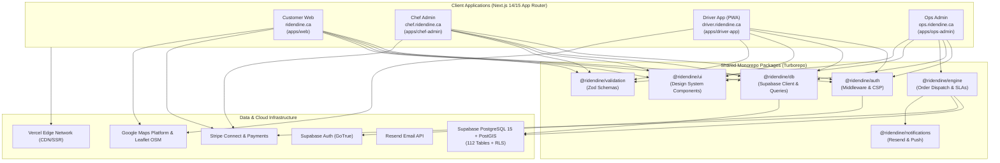

# RideNDine System Documentation Suite

> **Document Set Index & Reading Guide** | Project: RideNDine Marketplace | Date: October 7, 2026 | Commit: `5599c2e5` | Author: AI-generated from codebase audit | Confidence Summary: 18 CONFIRMED / 0 INFERRED / 0 UNKNOWN

---

## 1. Executive Summary

This documentation suite provides a complete, evidence-grounded technical and product audit of the **RideNDine Marketplace** as it exists in the codebase today. RideNDine is an on-demand, chef-first multi-sided food delivery and kitchen operations platform comprising four interconnected web applications, nine shared architectural packages, 104 routed user interface pages, 177 backend API routes, and 112 operational database tables.

All claims within this documentation suite are tagged with standardized confidence markers:
- `[CONFIRMED]`: Directly verified against source code, configuration files, schema definitions, or test execution output.
- `[INFERRED]`: Derived through engineering deduction from indirect evidence (with explicit supporting rationale).
- `[UNKNOWN]`: Flagged when required information cannot be determined from code alone (`"Not found in code – needs confirmation"`).

---

## 2. Document Set Navigation

The audit is structured into eight core documents designed for specific stakeholder roles:

| Document | Primary Audience | Scope & Purpose | File Link |
| :--- | :--- | :--- | :--- |
| **01 – Product Requirements Document (PRD)** | Business Owners, Product Managers, Founders | Details **WHAT** the platform does: product goals, user personas, an exhaustive catalog of all features (F-001 through F-045), business rules, commission structures, SLAs, and non-functional requirements. | [`01-PRD.md`](file:///D:/Projects/RIDENDINE/ridendine-marketplace/docs/01-PRD.md) |
| **02 – Technical Requirements Document (TRD)** | Engineers, Architects, DevOps, Security Auditors | Details **HOW** the system is built: architecture diagrams, monorepo package graph, full technology stack versions, security audit, deployment topology, and CI/CD pipelines. | [`02-TRD.md`](file:///D:/Projects/RIDENDINE/ridendine-marketplace/docs/02-TRD.md) |
| **03 – Application Flow Document** | UX Designers, Frontend Engineers, QA Teams | Maps **USER JOURNEYS**: complete 104-page route inventory, step-by-step user journeys (customer checkout, chef order fulfillment, driver dispatch, ops overrides), and Mermaid flowcharts. | [`03-App-Flow.md`](file:///D:/Projects/RIDENDINE/ridendine-marketplace/docs/03-App-Flow.md) |
| **04 – Design Brief** | UI/UX Designers, Frontend Developers | Details the **VISUAL DESIGN SYSTEM**: tokenized color palette, typography scales, container grids, responsive breakpoints, component catalog (buttons, inputs, cards), and a11y compliance. | [`04-Design-Brief.md`](file:///D:/Projects/RIDENDINE/ridendine-marketplace/docs/04-Design-Brief.md) |
| **05 – Backend Schema & API Catalog** | Backend Engineers, Database Admins, Integrators | Exhaustive data model: 112 tables, entity-relationship diagrams, foreign key trees, Row Level Security (RLS) policies, and catalog of all 177 API route handlers. | [`05-Backend-Schema.md`](file:///D:/Projects/RIDENDINE/ridendine-marketplace/docs/05-Backend-Schema.md) |
| **06 – As-Built Implementation Plan** | Engineering Leads, Program Managers, Executives | Historical timeline of 423 git commits, 9-point maturity scorecard, technical debt register, launch readiness checklist, and prioritized Tier 1–3 next steps. | [`06-Implementation-Plan.md`](file:///D:/Projects/RIDENDINE/ridendine-marketplace/docs/06-Implementation-Plan.md) |
| **07 – Open Questions Register** | Product Owner, External Partners, Systems Admin | Consolidated checklist of all `[UNKNOWN]` items requiring human business clarification (third-party credentials, legal terms, hardware printers, partner contracts). | [`07-Open-Questions.md`](file:///D:/Projects/RIDENDINE/ridendine-marketplace/docs/07-Open-Questions.md) |
| **08 – Cross-Document Consistency Report** | Lead Auditor, Technical Reviewers | Rigorous validation matrix checking cross-document coherence, unused endpoints, dead tables, permission mismatches, and env configuration gaps. | [`08-Consistency-Report.md`](file:///D:/Projects/RIDENDINE/ridendine-marketplace/docs/08-Consistency-Report.md) |

An interactive HTML version of this complete suite is available at [`index.html`](file:///D:/Projects/RIDENDINE/ridendine-marketplace/docs/index.html).

---

## 3. High-Level System Architecture

---

## 4. Key Metrics at a Glance

- **Applications:** 4 Next.js applications (`apps/web`, `apps/chef-admin`, `apps/driver-app`, `apps/ops-admin`) `[CONFIRMED: package.json]`
- **Monorepo Packages:** 9 internal packages (`@ridendine/*`) `[CONFIRMED: pnpm-workspace.yaml]`
- **Routed Pages:** 104 `page.tsx` files `[CONFIRMED: scripts/smoke/runtime-surface-classification.cjs]`
- **API Route Handlers:** 177 `route.ts` handlers `[CONFIRMED: scripts/smoke/runtime-surface-classification.cjs]`
- **UI Components:** 103 reusable component files `[CONFIRMED: packages/ui and apps/*/components]`
- **Database Tables:** 112 operational tables (113 including PostGIS `spatial_ref_sys`) `[CONFIRMED: information_schema.tables]`
- **Database Migrations:** 64 incremental SQL migrations `[CONFIRMED: supabase/migrations]`
- **Git Commit History:** 423 commits spanning March 21, 2026 to October 7, 2026 `[CONFIRMED: git log]`
